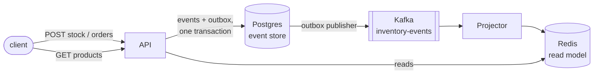

# inventory-events

An inventory service built with event sourcing. Every change to a product's
stock is stored as an event, and everything else (the current stock, the read
model, the API's answers) is derived from those events.

.NET 8, Postgres, Kafka, Redis, Docker Compose.

## How it fits together



- **Writes.** For each command the API loads the product's events, rebuilds
  its stock, decides what happens (reserve, reject, release) and appends the
  new events with the version it expects. If another request got there first,
  the append fails on the primary key and the command runs again on fresh
  history, after a short random pause.
- **Outbox.** Events and outbox rows are written in the same transaction, so
  nothing is stored without being published. A background publisher sends the
  outbox to Kafka, keyed by product so each product's events stay in order.
- **Read side.** The projector consumes the topic and keeps one view per
  product in Redis. Delivery is at least once, so it skips events it has
  already applied (by version) and commits offsets only after saving.
- **Rebuilding.** Because the events are the source of truth, the read model
  can be thrown away and rebuilt from the log at any time:
  `docker compose run --rm projector --rebuild`.

Reads are eventually consistent: a view can lag a write by a moment.

## Running it

```sh
docker compose up --build
```

The API listens on http://localhost:8080:

```sh
curl -X POST localhost:8080/products/lamp/stock -H "Content-Type: application/json" -d '{"quantity": 10}'
curl -X POST localhost:8080/orders -H "Content-Type: application/json" -d '{"orderId": "o1", "productId": "lamp", "quantity": 4}'
curl localhost:8080/products/lamp
# {"productId":"lamp","onHand":10,"reserved":4,"version":2,"available":6}
curl localhost:8080/products/lamp/events
curl -X DELETE localhost:8080/products/lamp/reservations/o1
```

| Endpoint | |
|---|---|
| `POST /products/{id}/stock` | Add stock: `{"quantity": n}` |
| `POST /orders` | Reserve stock: `{"orderId", "productId", "quantity"}`. 409 if there isn't enough |
| `DELETE /products/{id}/reservations/{orderId}` | Release a reservation |
| `GET /products`, `GET /products/{id}` | Current stock, from the read model |
| `GET /products/{id}/events` | Every event of a product |

## Tests

```sh
dotnet test
```

Unit tests cover the stock rules and the projection. Integration tests run
against real Postgres and Redis containers (Testcontainers, so Docker has to be
running), including ten orders arriving at once for five items in stock:
exactly five are reserved, never more.

## Layout

```
src/Inventory.Domain      events, stock rules, projection (no I/O)
src/Inventory.Api         HTTP API, Postgres event store, outbox publisher
src/Inventory.ReadModel   Redis views
src/Inventory.Projector   Kafka consumer that keeps the views up to date
tests/                    unit and integration tests
```
